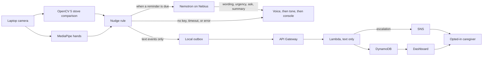

# Nudge

Nudge is a real-time camera helper for dementia care. People living with dementia sometimes start a task, walk away, and do not come back. A pot left on the stove is the case this prototype watches. Nudge does not scold and it does not beep like an alarm. It waits, and if the stove still looks occupied and nobody is nearby, it speaks a short, calm reminder. If nothing changes, it says so again a little more directly. After those reminders go unanswered, it asks a caregiver once. When the person returns, or the stove is clear, it stops.

This is a prototype for an OpenCV project. It is not a medical device, and it is not a substitute for someone checking in or for a real stove shutoff.

## How it works

Seeing and deciding happen on the laptop:

1. **Hands.** MediaPipe's hand landmarker looks for hands in a zone you draw (the counter, by default). A hand counts only after it has been seen for about a second, so a flicker does not spam the log. Hands over the stove count too, so stirring a pot counts as "someone is here" even if the hand zone is the counter beside it.
2. **Stove.** You draw a box around the stove and photograph it while it is empty (`B`). Each new frame is compared with that picture. The percentage of pixels that changed is shown on screen. Above 5%, the stove counts as occupied, again only after the change holds for about a second. Broad lighting is cancelled before that comparison, and while the stove stays clear the empty picture drifts slowly so daylight does not pile up into a false "something was placed" event. That drift stays in memory. It is not written back over the photo you saved with `B`.
3. **Nudge.** If the stove stays occupied and no hands have been nearby, a clock starts. The default wait is **3 minutes** (`--nudge-after 180`). The first reminder is "Something is still on the stove." If nobody comes back, Nudge speaks again after **1 minute** (`--nudge-repeat 60`), then in slightly more direct words, and then stops getting sterner. Coming back or clearing the stove resets the clock. The next absence waits the full 3 minutes again. When a reminder is due and `NEBIUS_API_KEY` is set, NVIDIA Nemotron chooses the spoken wording, the urgency, whether to ask the caregiver, and the caregiver summary. See [Nebius x NVIDIA](#nebius-x-nvidia). If the key is missing or the call fails, the sentences above are what is spoken.
4. **Caregiver.** After four spoken reminders (the default), the next quiet minute produces one request: "I haven't seen you come back, so I'm letting your caregiver know." That sentence is spoken in the room and written to the log. It does not claim the message has already been delivered. `--no-escalate` keeps repeating the last reminder instead. A new absence, after the person comes back or the stove is cleared, can ask again.

The decision is a function of what the camera has confirmed: stove occupied or clear, hands nearby or away, how long the stove has been unattended, and how many reminders are still unanswered. Each check is one line in `data/decisions.jsonl`.

Lighting is handled in two ways, because a lamp or a cloud used to look exactly like a pot:

- Before comparing, each stove picture is divided by a wide blur. Light that falls across the whole zone drops out. A pot is smaller than that blur, so it stays. This step is always on in the live camera.
- While the stove is confirmed clear, the empty picture drifts slowly toward the live view (on the order of a minute). Afternoon daylight can ease in. The drift stops at the first frame that might contain an object, so a pot is not learned away.

## Architecture



The cloud boxes are optional. `NUDGE_CLOUD` defaults to `off`, and then the diagram stops at the laptop except for the Nemotron call, which also stays off until `NEBIUS_API_KEY` is set. When cloud mode is `mock` or `aws`, only the text event is sent. Frames never leave the device; only text events go to AWS, with caregiver consent. The Nemotron request is the same kind of text: seconds unattended, reminders already spoken, and the last sentence. It does not include a frame.

## Nebius x NVIDIA

When a reminder is already due, Nudge can ask NVIDIA Nemotron 3 Super, through Nebius Token Factory, what to say and whether this is the moment to ask the caregiver. The clock does not move to the model. The model is called once per due moment, not on every camera frame. It returns:

- the sentence to speak in the room
- an urgency of calm, direct, or firm
- `remind` or `escalate`
- a short caregiver summary when it escalates

The room still hears one reminder before any caregiver ask. `--no-escalate` cannot be overridden. After the reminder cap (default 4), the caregiver is asked even if the model wanted another reminder, and the model's summary is kept when it wrote one. A sentence that scolds, or that claims someone was already contacted, is discarded. That includes a claim that never says "caregiver". The same check runs again if an ask is turned back into a reminder, so the room does not hear it.

If `NEBIUS_API_KEY` is unset, or the call times out or returns something unusable, the built-in ladder speaks and the reason is appended to `data/decisions.jsonl`. The camera loop is not raised into.

### Key, model, and URL

Create an API key in [Nebius Token Factory](https://tokenfactory.nebius.com) (API keys). Put it in `.env`, which is gitignored. Copy from `.env.example`. Real environment variables win over the file. Do not commit the key.

```bash
NEBIUS_API_KEY=your-token-factory-key
```

Optional:

| Variable | Default | Meaning |
| --- | --- | --- |
| `NEBIUS_MODEL` | `nvidia/nemotron-3-super-120b-a12b` | NVIDIA Nemotron model id. This is the text-to-text Super model in the [Token Factory Nemotron quickstart](https://nebius.com/services/token-factory/nemotron) and the [cookbook](https://github.com/nebius/token-factory-cookbook/blob/main/models/nemotron/nemotron3-super-120B.md). The public catalog lists it in `us-central1`. |
| `NEBIUS_BASE_URL` | `https://api.tokenfactory.us-central1.nebius.com/v1` | OpenAI-compatible base URL for that model. The client calls `{base}/chat/completions`. The host must be HTTPS and on the Token Factory allowlist (`api.tokenfactory.nebius.com` and the regional `api.tokenfactory.<region>.nebius.com` hosts). An http URL, a lookalike host, or anything else is refused and the key is not sent. |

The request sets `stream` to false, `reasoning_effort` to `low` so the reply stays short, and `response_format` to a JSON object. If the host rejects those extra fields, the client tries once more as a plain chat completion. The timeout is 20 seconds.

One sample event, with no camera, for a demo recording:

```bash
export NEBIUS_API_KEY=your-token-factory-key
python scripts/demo_nemotron.py
```

That sample is a stove left occupied, hands away, for 240 seconds, after two reminders. The script prints the decision, or the fallback, and exits 1 when it had to fall back. `--away` and `--reminders` change the sample. Nothing in the request is a picture, and the key is not printed.

### What's new since Aug 26

26 August 2026 is before anything in this repository. The first commit is 19 October 2026. Since that cutoff the project gained, in order:

- hand detection in a zone you draw, with a one-second debounce and a plain-language event log
- stove occupancy by comparing the live stove to an empty photo, including lighting normalization so a lamp is not a pot
- the reminder clock, offline speech (voice, then a chime, then the console), and the on-screen banner
- one caregiver ask after the spoken reminders, a decision log, and an optional text-only path to a local dashboard or to AWS (API Gateway, Lambda, DynamoDB, SNS)
- this branch: a live Nemotron decision on Nebius Token Factory at each due moment, with the rule ladder kept as the fallback

Hardware is not required for the Nemotron step. `scripts/demo_nemotron.py` is enough to show the live call.

## Privacy

With the default settings, everything stays on the machine. The camera frames are not uploaded. There is no account. Nemotron is not called unless `NEBIUS_API_KEY` is set. The only network request without that key, and without cloud mode, is an optional download of the hand model, and only when `models/hand_landmarker.task` is missing. That file is already in the repository so a demo can run offline.

If you turn cloud mode on, frames never leave the device; only text events go to AWS, with caregiver consent. A text event is a time, a short sentence, and a few numbers (how long the stove has been unattended, how many reminders went unanswered). The client rejects a field that looks like a picture. The API key travels in a header, not in the event.

What is written to disk, under `data/` (gitignored):

- `zones.json`, the boxes you draw
- `stove_reference.png`, the empty-stove photo
- `events.jsonl`, a plain-language activity log
- `decisions.jsonl`, one line per check of the rule, including the waits
- `outbox.jsonl`, text events that could not be delivered yet

Delete `data/` to forget a session.

## Setup

Python 3.10 or newer. On macOS, allow the terminal (or the IDE) to use the camera under System Settings, Privacy & Security, Camera.

```bash
python3 -m venv .venv
source .venv/bin/activate
pip install -r requirements.txt
```

The hand model is MediaPipe's hand landmarker, about 8 MB, stored at `models/hand_landmarker.task`. It is committed on purpose. `ensure_model()` can download the same file from Google's model storage, but a judging laptop may be offline, and without the file the camera loop cannot start. The model is separate from this project's MIT license. Use it under MediaPipe's own terms.

`sounddevice` is used only for the fallback chime. On macOS the spoken reminder uses the built-in `say` command, which is offline. Linux uses `espeak` or `espeak-ng` if one of those is installed. Windows uses the built-in speech synthesizer. If none of that can play audio, Nudge prints the sentence and, when it can, plays a short two-note chime. If that also fails, the sentence is only printed. The camera loop does not wait on the voice.

OpenCV is pinned as `opencv-contrib-python==5.0.0.93`. Where that wheel is installed, `cv2.__version__` reports `5.0.0`.

## Run

From the repository root:

```bash
python src/main.py
```

A short demo, so you do not have to wait three minutes and four reminders:

```bash
python src/main.py --nudge-after 15 --nudge-repeat 10 --max-reminders 2
```

With those numbers the first reminder is at 15 seconds, the second at 25 seconds, and the caregiver ask at 35 seconds. The real defaults are 180, 60, and 4, so the ask is about seven minutes after the hands leave.

Other flags:

| Flag | Default | Meaning |
| --- | --- | --- |
| `--cam` | `0` | Camera index. Try `--cam 1` if the wrong camera opens. |
| `--zone` | `counter` | Name of the hand zone to load or create. `stove` is reserved. |
| `--nudge-after` | `180` | Seconds with nobody nearby before the first reminder. |
| `--nudge-repeat` | `60` | Seconds between later reminders, and before the caregiver ask. |
| `--max-reminders` | `4` | Spoken reminders before one caregiver request. |
| `--no-escalate` | off | Keep repeating the last reminder. Do not ask a caregiver. |
| `--list-zones` | | Print saved zones and exit. No camera needed. |

Patience is these flags. It is not an environment variable.

### Keys

| Key | Action |
| --- | --- |
| `Z` | Draw or replace the hand zone. Drag a rectangle, then Enter. Esc cancels. |
| `S` | Draw or replace the stove zone. Take a new empty photo afterward. |
| `B` | Photograph the empty stove. Do this with the burners clear. |
| `Q` | Quit. |

Suggested first run: press `Z` and box in the counter where hands rest while cooking, press `S` and box in the burners, press `B` while the stove is empty, then set a pot down and walk out of view.

The stove label shows the live change, for example `STOVE 1.2% (clear)` or `STOVE 12.0% (occupied, away 20 seconds)`. When a reminder is due, a warm banner across the top shows the same words that are spoken.

## Event log

Each line in `data/events.jsonl` is one JSON object with `time`, `event`, and `observed`:

```json
{"time": "2026-10-24T18:05:01", "event": "stove_item_placed", "observed": "Something was placed on the stove"}
{"time": "2026-10-24T18:08:12", "event": "nudge", "observed": "Something is still on the stove."}
{"time": "2026-10-24T18:15:12", "event": "escalate", "observed": "I haven't seen you come back, so I'm letting your caregiver know."}
{"time": "2026-10-24T18:16:40", "event": "nudge_ended", "observed": "Someone came back, so the reminder stopped."}
```

`nudge` is a spoken reminder. `escalate` is the one caregiver ask. `nudge_ended` is written when a reminder stops, and the sentence says whether someone came back or the stove is clear.

`data/decisions.jsonl` is the longer trace. About once a second, and again whenever a reminder, an ask, or a stop happens, it stores a line such as `REMIND     stove occupied, hands away, away for 180s, 1 reminder unanswered`. Waits are in that file. They are not printed on every frame. When Nemotron chose the step, that same line also stores `source`, `model`, `action`, `urgency`, `message`, and, for an ask, `caregiver_summary`. When the call was skipped or failed, the line stores `fallback` instead. The API key is never one of the fields.

## Caregiver events

`NUDGE_CLOUD` chooses where text events go:

| Value | What happens |
| --- | --- |
| `off` | Default. The spoken ask still happens. Nothing is sent. |
| `mock` | POST text events to `scripts/mock_cloud.py` on this machine. |
| `aws` | POST text events to the deployed API Gateway URL. |

Copy `.env.example` to `.env` (gitignored). Real environment variables win over the file. A failed send is appended to `data/outbox.jsonl` and tried again later. The camera loop is not raised into. The spoken reminder does not wait for the network.

### Local dashboard, no AWS account

```bash
python scripts/mock_cloud.py
```

The process prints a dashboard URL. In another terminal:

```bash
NUDGE_CLOUD=mock NUDGE_API_URL=http://127.0.0.1:8787 NUDGE_API_KEY=local-dev-key \
  python src/main.py --nudge-after 15 --nudge-repeat 10 --max-reminders 2
```

`local-dev-key` is for that localhost server only. The AWS client refuses to send it. Open the health page with no token. It must not list events. Open the dashboard URL the server printed.

## Deploy to AWS

The template is `aws/template.yaml`. It creates:

- an HTTP API (API Gateway)
- one Python 3.12 Lambda (`aws/src/app.py`, 128 MB, 10 second timeout, x86_64)
- a DynamoDB table of text events, on-demand, deleted after 30 days
- an SNS topic for escalation email or SMS
- the dashboard page judges and caregivers open

No video bucket is created. `boto3` comes with the Lambda runtime, so `aws/src/requirements.txt` is only a comment.

This repository was checked with SAM CLI 1.170.0:

```bash
SAM_CLI_TELEMETRY=0 sam validate --lint -t aws/template.yaml
sam build -t aws/template.yaml
```

Both succeeded. The stack was not deployed. This environment has no AWS credentials, and none should be committed.

### Before you start

You need an AWS account and permission to create CloudFormation stacks, IAM roles, Lambda functions, API Gateway APIs, DynamoDB tables, and SNS topics. The resources above are small. Email through SNS is enough for a demo. SMS can cost money and, in many accounts, stays in the SNS sandbox until AWS approves production SMS. Start with email.

Install the [AWS CLI](https://docs.aws.amazon.com/cli/latest/userguide/getting-started-install.html) and the [SAM CLI](https://docs.aws.amazon.com/serverless-application-model/latest/developerguide/install-sam-cli.html). Then:

```bash
aws configure
```

Use an access key and a region such as `us-east-1`. Do not put that key in this repo.

Pick two random secrets of at least 20 characters. One is the laptop ingest key. One is the dashboard token. Do not reuse `local-dev-key`. A separate dashboard token is safer: the dashboard link contains the read token, and that token cannot create events when it differs from the ingest key.

### Deploy

```bash
cd aws
sam build
sam deploy --guided
```

Answer the prompts like this:

1. Stack name: `nudge-caregiver`
2. Region: the region from `aws configure`
3. Parameter `IngestApiKey`: the laptop secret
4. Parameter `DashboardToken`: the read secret, or leave it blank to reuse the ingest key
5. Parameter `CaregiverNotifyEmail`: the caregiver's email, or leave it blank and subscribe later
6. Confirm changes before deploy: Yes
7. Allow SAM CLI IAM role creation: Yes
8. Disable rollback: No
9. Save arguments to a configuration file: Yes is convenient

`sam deploy --guided` writes `aws/samconfig.toml`. That file can contain your API keys. It is gitignored. Do not commit it. Do not commit `.env`.

When the deploy finishes, note the outputs: `ApiUrl`, `HealthUrl`, `DashboardUrl`, and `CaregiverTopicArn`.

If you set an email, AWS sends a confirmation to that address. Escalations are stored either way, but email does not arrive until the caregiver clicks the confirmation. That click is the opt-in.

To subscribe a phone later, after you accept SMS cost and any sandbox limits:

```bash
aws sns subscribe \
  --topic-arn YOUR_CAREGIVER_TOPIC_ARN \
  --protocol sms \
  --notification-endpoint +15551234567
```

### Point the laptop at the stack

In `.env` on the laptop:

```bash
NUDGE_CLOUD=aws
NUDGE_API_URL=https://YOUR_API_ID.execute-api.YOUR_REGION.amazonaws.com
NUDGE_API_KEY=the-ingest-secret
NUDGE_DASHBOARD_TOKEN=the-dashboard-secret
NUDGE_DEVICE_NAME=kitchen
```

`NUDGE_API_URL` has no `/events` on the end. The client adds that path. Reminder timing stays on the camera command (`--nudge-after`, `--nudge-repeat`, `--max-reminders`). It is not set in `.env`.

Check the public page in a browser: the `HealthUrl` output. It must load without a token and must not list events.

Open `DashboardUrl?token=YOUR_DASHBOARD_TOKEN`. The table starts empty. Run the camera app and refresh. You should see text rows only.

To read the outputs again:

```bash
aws cloudformation describe-stacks \
  --stack-name nudge-caregiver \
  --query "Stacks[0].Outputs"
```

### Remove the stack

```bash
sam delete --stack-name nudge-caregiver
```

## Tuning

Watch the on-screen percentage with the stove empty, with a light switched on, and with a pot in place. Empty, including a brightness change, should sit well under 5%. A pot should sit comfortably above it. If your kitchen falls in between, edit `OCCUPIED_PERCENT` or `PIXEL_DIFF_THRESHOLD` in `src/stove.py`.

`DEBOUNCE_SEC` in `src/main.py` is the one-second pause before a hand or a stove change is believed. Reminder times shorter than a couple of seconds fight that pause. Use 15 seconds or more for a demo.

The hand zone should cover where hands actually are while someone cooks. Hands inside the stove box count as nearby even if the hand zone does not overlap it.

## Tests

No camera and no AWS account are required:

```bash
pip install -r requirements.txt -r requirements-dev.txt
python -m unittest discover -s tests -v
pytest
ruff check src tests scripts aws
```

`requirements-dev.txt` pins `pytest==8.4.2` and `ruff==0.14.2`.

The tests cover the reminder clock and the one caregiver ask, a Nemotron decision with the HTTP call mocked (including a missing key, a timeout, and an HTTP error), the lighting comparison (drawn pictures, not a webcam), the slow empty-picture drift, the voice/tone/console fallback, the command-line defaults, the text-only client, the local dashboard, the Lambda handler with AWS replaced by fakes, and the shape of an evaluation report. They do not measure a kitchen, and they do not call Nebius.

## Evaluation

The live stove test and the "normalization on" column are the same code: crop, grayscale, blur, cancel broad lighting, absolute difference, a pixel threshold, a small noise filter, then a one-second debounce. The "normalization off" column skips only the lighting step, so a real recording can show what that step changes. It is not what the camera does. The slow daylight drift is live-only and is not part of these rates.

Record clips only when you can film the real stove. Keep the framing identical, with the stove filling the frame, for the empty reference and every clip.

1. Copy `eval/labels.example.csv` to `eval/labels.csv`.
2. Save a normal still of the empty stove as `eval/clips/reference.png`. Do not use `data/stove_reference.png`. That file is already cropped and blurred.
3. Record clips. One way, with the camera that will be scored:

   ```bash
   python scripts/record_clip.py --cam 0 --seconds 12 --out eval/clips/empty_daylight.mp4
   ```

   Useful set, if you can film it: empty in daylight, empty with a lamp on or off, a pot or pan on the burner, the same pot in dimmer light, and a clip where hands stay in frame. Name the failure cases you care about (a shiny empty stove, a cloth the same color as the cooktop, a person still cooking but outside the hand zone and the stove box).
4. Add one CSV row per file. `label` is `occupied` or `clear`. `hands` is `present` or `absent` and is used only for time-to-first-nudge.

   ```text
   file,label,hands
   empty_daylight.mp4,clear,absent
   pot_on_burner.mp4,occupied,absent
   ```

5. Run:

   ```bash
   python scripts/evaluate_stove.py \
     --clips eval/clips \
     --labels eval/labels.csv \
     --reference eval/clips/reference.png
   ```

The default `--remind-after` is 180 seconds, the same first wait as the camera. Pass `--remind-after 15` if you want the extrapolated time to use the short demo wait. Say which one you used when you fill the table in.

Clips in `eval/clips/` are gitignored so kitchen video is not committed by accident.

The script prints a detection rate (occupied clips it calls occupied), a false-alarm rate (clear clips it calls occupied), and time-to-first-nudge, with normalization off and on. Time-to-first-nudge is measured from the moment the stove is confirmed occupied with no hands. A short clip is held forward on the reminder clock and marked extrapolated. That number is the reminder setting plus detection, not a claim that a long video was recorded.

If there are no rows, the script prints `n/a`. That is not a zero and it is not a result.

### Results

FILL IN after a real run. Copy the figures from the script. Do not type a number the script did not print. Do not copy numbers from the unit tests. Those tests draw rectangles and flat color fields. They are not a kitchen.

| Setting | Clips scored | Detection rate | False-alarm rate | Time to first nudge | Failure cases |
| --- | --- | --- | --- | --- | --- |
| Lighting normalization off (comparison only; the camera always normalizes) | FILL IN | FILL IN | FILL IN | FILL IN | FILL IN |
| Lighting normalization on (this is what the camera does) | FILL IN | FILL IN | FILL IN | FILL IN | FILL IN |

Recorded on: FILL IN

Camera, room, and what each failure looked like: FILL IN

`--remind-after` used for the time column: FILL IN

Leave this table as FILL IN until those clips exist. A blank table is the honest state of the evaluation today.

## Responsible use

- Frames never leave the device; only text events go to AWS, with caregiver consent.
- The person at the stove should know the camera is on and what will be said.
- A caregiver is opted in. Email does nothing until they confirm the SNS subscription. Share the dashboard URL only with that person and with judges. The token in the URL is a secret. It can sit in browser history.
- Nudge is not a medical device, not a fire alarm, and not a substitute for someone watching a person who needs care. It can miss a boil-over, a fire, or a fall. It can also nudge when the stove is fine.
- One escalation is requested per absence, not a stream of messages. Hands coming back, or the stove being cleared, closes that episode. With `NUDGE_CLOUD=off` the ask is spoken and logged on the laptop only.
- Do not point this at someone who has not agreed to it. Do not use it as covert surveillance. The product stores text about a task, not a record of a person's face. The hand model looks for hands inside a zone you draw. It does not identify who the person is.
- API keys live in `.env` on the laptop and in the Lambda configuration in AWS. Anyone who can read the function's environment can read those keys. Rotate them if they leak. `local-dev-key` must not be deployed. `NEBIUS_API_KEY` is the same kind of secret. It is sent only as a bearer token to Token Factory, and only at a due moment. It is not written to the decision log or the event body.
- DynamoDB items expire after 30 days. Delete the stack when the demo is over.
- If the network is down, the spoken reminder still happens on the laptop. The caregiver message waits in `data/outbox.jsonl` and may arrive late or not at all.

## Limitations

- Nudge cannot see heat. A cold pot and a hot burner look the same if they change the picture. A cloth left on the stove can cause a reminder too.
- A small item, such as a teaspoon, may stay under the 5% line after the stove image is blurred to hide camera noise.
- A hard shadow that cuts across the stove, or a camera that gets bumped, can still look like an object. Press `B` again after you move the camera.
- Smooth lighting changes (a lamp, a window, auto-exposure) are what the lighting step is built for. It is not a promise about every shadow.
- The reminder only knows that hands were in view. It does not know who the person is, and it misses hands that are out of frame or hidden.
- There is one stove zone. The reference photo is the one you last saved with `B`. The slow daylight drift is kept in memory and is not written back over that photo.
- If the laptop has no working voice and no speaker, the reminder is only on screen and in the terminal.
- The caregiver path is optional and fails soft. A dead network means the dashboard and the email can lag or never arrive. The sentence in the room still does not mean the caregiver has already been told.
- Nemotron sees the same numbers the rule sees. It does not see the camera. The first due moment stays a reminder, and the reminder cap still asks the caregiver once. Without a key, or when Token Factory does not answer within 20 seconds, the built-in sentences are used.
- The AWS stack in this repository has been validated and built locally. It has not been deployed from here.

## What you still do by hand

This branch was not deployed to AWS, and it was not filmed in a kitchen.

- Deploy with the steps above, confirm the caregiver email, and put `ApiUrl` and the keys in `.env`. Do not commit `.env` or `aws/samconfig.toml`.
- On the real camera (`--cam` defaults to `0`), press `Z` and `S` to draw the zones, then press `B` while the stove is empty.
- Reminder timing is `--nudge-after` (default 180), `--nudge-repeat` (default 60), and `--max-reminders` (default 4). `--no-escalate` keeps the older repeat-forever behavior. Those are command flags, not `NUDGE_REMIND_*` variables.
- With `NUDGE_CLOUD` left at `off`, the caregiver sentence is spoken and logged only. It is sent after you set `NUDGE_CLOUD=aws` and the stack is up.
- Record the clips and paste the script's numbers into the results table. The "on" column is the live camera. The "off" column is the comparison that skips lighting normalization. The live daylight drift is not in either column.
- Listen to the reminder on the machine that will be demoed. Voice, then a soft chime, then the terminal, depending on what that machine has.

## Layout

| Path | Role |
| --- | --- |
| `src/main.py` | Camera loop, zones, speech, decision log, optional send |
| `src/nudge.py` | Reminder clock and the one caregiver ask. No camera. |
| `src/reason.py` | Nemotron decision via Nebius Token Factory, with a rule fallback. |
| `scripts/demo_nemotron.py` | One sample event, one live Nemotron call. No camera. |
| `src/stove.py` | OpenCV occupancy, lighting normalization, empty-picture drift |
| `src/speak.py` | Offline voice, then a chime, then the console |
| `src/cloud.py` | Text-only client and offline outbox |
| `scripts/mock_cloud.py` | Local caregiver API and dashboard |
| `scripts/evaluate_stove.py` | Clip scoring |
| `scripts/record_clip.py` | Record a clip for that scoring |
| `aws/template.yaml` | SAM stack |
| `aws/src/app.py` | Lambda |
| `aws/src/dashboard.html` | Caregiver page, also served by the mock |
| `docs/REPORT.md` | Technical report |
| `eval/labels.example.csv` | Labels format |

## License

The code is MIT. See `LICENSE`.
