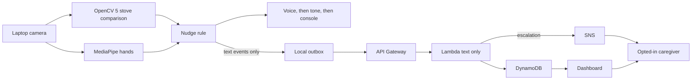

# Nudge technical report

Status: the software in this repository is what this report describes. The AWS stack has been validated locally and has not been deployed. The kitchen evaluation table is empty on purpose. No rate below is a measured kitchen result.

## Problem

A person starts a stove task and walks away before it is finished. They may need a reminder to come back. If they do not, someone who has agreed to help (a caregiver or a nurse) should hear about it. The reminder should follow what the camera is seeing now, not a timer that ignores the room.

Nudge is that reminder. It is not a safety system and it is not a medical device. It can miss a hazard, and it can speak when the stove is fine.

## Users

- The person at the stove. They hear a short spoken prompt on the laptop. They should know the camera is on.
- An opted-in caregiver or nurse. They can open a dashboard of text events and, after they confirm a subscription, receive an email or SMS when an episode escalates. They do not receive video.

No other audience is intended. The system is not for identifying people or for watching someone who has not agreed.

## Architecture

Seeing happens on the laptop. OpenCV 5 compares the stove zone with a photo of the empty stove, after broad lighting is cancelled. MediaPipe's hand landmarker reports whether a hand is inside a zone the user draws, or over the stove. Those two facts are debounced for about a second, then handed to `src/nudge.py` with a clock. The rule waits, speaks a reminder, or asks a caregiver once. Coming back or clearing the stove closes the episode and starts the full wait over next time.

Only a small JSON event can leave the laptop: time, a short description, the action, and a few numbers (how long the stove has been unattended, how many reminders are unanswered). Frames never leave the device; only text events go to AWS, with caregiver consent. `NUDGE_CLOUD=off` is the default and sends nothing.

On AWS, API Gateway accepts the JSON, a Lambda checks it again, DynamoDB stores it for 30 days, and SNS sends a plain-text escalation to a confirmed subscription. A dashboard page reads the same text. There is no bucket for video. The template is `aws/template.yaml`.

If the POST fails, the event stays in `data/outbox.jsonl` on the laptop and is retried. The spoken reminder does not wait for the network. `NUDGE_CLOUD=mock` uses a local server with the same JSON and the same dashboard, so the path can be shown without an AWS account.

## OpenCV 5

Core occupancy uses OpenCV, pinned as `opencv-contrib-python==5.0.0.93` in `requirements.txt`. On a machine where that wheel was installed, `cv2.__version__` reported `5.0.0`.

For each frame the live path, in `src/stove.py` and `src/main.py`:

- crops the stove zone
- converts it to grayscale (`cvtColor`)
- blurs it (`GaussianBlur`) to hide sensor grain
- divides by a wider blur so light across the whole zone drops out, then rescales the mean to mid-gray (`normalize_lighting`)
- takes the absolute difference from the empty-stove reference (`absdiff`)
- thresholds changed pixels (`threshold`, difference above 30)
- removes isolated noise (`morphologyEx` open)
- calls the zone occupied when at least 5 percent of pixels changed

That lighting step is always on in the camera. A second helper, `change_percent_raw`, skips it. Only the clip report calls the raw helper, so a recording can show the difference. The camera does not.

A one-second debounce (`Debounced`) stops a single noisy frame from logging "placed" and "clear" back to back. The empty reference is a picture the user takes with the `B` key, stored only on the laptop. While both the raw frame and the debounced state say the stove is clear, the reference blends a little toward the live view (`adapt_reference`, on the order of a minute, and never more than a few seconds of blend in one step). That drift lives in memory. Saving happens when the user presses `B`, which writes the current picture as a PNG. The drift is not written back over that file by itself, and the clip report does not simulate it.

This is not an object detector. It cannot name a pot. Anything that changes the pixels enough counts, including a hard shadow. A lamp or a cloud is what the lighting step is for. It is not a promise about every shadow. An object that fills the whole zone can be flattened with the lighting, because it looks like the illumination.

Hands are a separate signal. MediaPipe's hand landmarker (`mediapipe==1.1.1`, model file `models/hand_landmarker.task`) marks hands. Nudge counts a hand when a landmark falls inside the drawn working zone or inside the stove box. OpenCV draws the zones, the stove percentage, and the reminder banner (`rectangle`, `putText`, `imshow`).

## The decision

`src/nudge.py` does not import OpenCV, MediaPipe, or the network. Tests hand it a clock and two booleans: stove occupied, hands nearby.

The clock starts on the first sample where the stove is occupied and hands are away, not when the pot was set down. Standing at the stove does not use up the wait. The defaults are a first reminder after 180 seconds and a repeat every 60 seconds. Wording gets a little more direct across four sentences, then stays on the last one.

`max_reminders` defaults to omitted, which repeats that last sentence. The camera passes 4 unless `--no-escalate` is set. After that many spoken reminders, the next repeat interval returns one escalation: "I haven't seen you come back, so I'm letting your caregiver know." Further checks while the person is still away do nothing. Coming back or clearing the stove ends the episode, because a reminder was showing, and the next absence waits the full first interval again.

`describe()` writes one line of those facts. `src/main.py` appends it to `data/decisions.jsonl` about once a second and again when it speaks, asks, or stops. The activity log stays in `data/events.jsonl`.

When `NEBIUS_API_KEY` is set, the camera asks `src/reason.py` at a due moment and not during the waits. That module posts the same facts (no frame) to Nebius Token Factory and NVIDIA Nemotron 3 Super (`nvidia/nemotron-3-super-120b-a12b` on `https://api.tokenfactory.us-central1.nebius.com/v1`). The model may replace the canned sentence, the urgency, and the choice between another reminder and the caregiver ask, and it writes the caregiver summary. The caps in this section still apply. A missing key, a timeout, or a bad reply leaves the ladder above in place, and that reason is stored on the decision line. The clip scorer does not set a key, so the evaluation path is unchanged.

Speech is `src/speak.py`. It tries a local voice (`say` on macOS, `espeak-ng` or `espeak` on Linux, the Windows speech synthesizer), then a short two-note chime, then the console. `say()` returns immediately. The rule does not know whether a caregiver message was delivered. The sentence asks. Delivery is the network and the confirmed subscription. With cloud mode off, delivery does not happen at all. The sentence is still spoken.

## AWS deployment

Intended resources, from `aws/template.yaml`:

| Piece | Role |
| --- | --- |
| HTTP API | `GET /` and `GET /health` are public and contain no events. `GET /dashboard` is the page. `GET /events` needs the dashboard token or the ingest key. `POST /events` needs the ingest key in the header. A query token cannot write. |
| Lambda `aws/src/app.py` | Validates the JSON again, writes the item, publishes SNS only for an escalation. Store happens first. A failed publish still returns 201 with `notified: false`. |
| DynamoDB | Partition `nudge`, sort key time plus an id. TTL attribute `ttl`, 30 days. On-demand billing. |
| SNS | Email subscription if an address is given at deploy time. The caregiver must click the confirmation. SMS is a manual subscribe so a phone number is not baked into the template. |

The ingest key and the dashboard token are CloudFormation parameters (`NoEcho`), not files in git. `IngestApiKey` must be at least 20 characters. The Lambda rejects `local-dev-key` and any ingest key shorter than 20 characters by returning 500 "server API key is not configured". A dashboard token, when it is different from the ingest key, can read events and cannot create them.

The laptop client in `src/cloud.py` uses the same field list. `tests/test_lambda.py` fails if a payload is accepted on one side and rejected on the other. Picture-shaped keys, `data:image` and `data:video` strings, strings over 2000 characters, and payloads over 4096 bytes are rejected. `boto3` is imported inside the Lambda's table and SNS helpers, so the tests do not need it. The escalation text says no video was included.

Checked in this workspace with SAM CLI 1.170.0: `sam validate --lint -t aws/template.yaml` and `sam build -t aws/template.yaml`. The build contained `app.py`, `dashboard.html`, and `requirements.txt`, and no video assets. Deploy was not run. There were no AWS credentials. The README has the click-by-click deploy for someone who has not used AWS before, including the SNS confirmation and the `.env` values to copy from the stack outputs.

Known limits of this deploy shape:

- The API keys are Lambda environment variables. Anyone who can read the function configuration can read them.
- The dashboard URL includes the read token, so it can land in browser history and access logs.
- SMS may not leave the account until the SNS sandbox is lifted, and it can cost money. Email is the path the template sets up directly.
- A failed SNS publish still keeps the event in DynamoDB. The dashboard can show an escalation that email has not delivered yet.

## Evaluation

`scripts/evaluate_stove.py` scores a folder of clips against `eval/labels.csv` and an empty-stove still. The still is a normal photo, not `data/stove_reference.png`. For each clip it reports two columns:

- normalization off: `change_percent_raw`, which the camera does not use
- normalization on: `change_percent`, which is the live comparison

For each column:

- detection rate: occupied clips the debounced test calls occupied
- false-alarm rate: clear clips the test calls occupied
- time-to-first-nudge: seconds from the first confirmed occupied sample, with hands marked absent, until `NudgeRule` speaks the first reminder

The debounce is `main.DEBOUNCE_SEC` (1 second). The default reminder wait is `nudge.DEFAULT_WAIT_SECONDS` (180). `--remind-after` overrides it and should be written down with the results. A clip that is shorter than the reminder delay is extended by holding the last reading, and the report says the number was extrapolated. Unreadable files are listed and are not counted as hits or misses. An empty labels file prints `n/a`, not zero. The live empty-picture drift is not part of these rates.

### Results

Not measured on a kitchen yet. Do not treat any unit-test figure as this table.

| Setting | Clips scored | Detection rate | False-alarm rate | Time to first nudge | Failure cases |
| --- | --- | --- | --- | --- | --- |
| Lighting normalization off (comparison only; the camera always normalizes) | FILL IN | FILL IN | FILL IN | FILL IN | FILL IN |
| Lighting normalization on (this is what the camera does) | FILL IN | FILL IN | FILL IN | FILL IN | FILL IN |

Recorded on: FILL IN

Notes on the room, camera, and each failure: FILL IN

`--remind-after` used: FILL IN

How to record the clips and fill this table is in the README. `scripts/record_clip.py` writes one clip with the `mp4v` codec. `eval/labels.example.csv` is the labels format.

Unit tests do draw images: a flat brightness change, and a dark rectangle on a flat field. They check that the arithmetic and the report format behave. They are not a substitute for the table above. The README says the same thing so a reader does not copy a test assertion into the results.

Failure cases the harness will list, once clips exist: misses (occupied clip called clear), false alarms (clear clip called occupied), and unreadable files (missing, or filmed at a different size from the reference). Likely real-world failures, not yet measured: a hard shadow, a pot whose color is close to the cooktop, the camera or the zone being moved after `B`, and hands that leave both the drawn zone and the stove box while the person is still cooking.

## Limitations

- Occupancy is pixel change against one photo. It does not know what the object is, and it cannot see heat.
- The user must draw both zones and photograph an empty stove. Move the camera and the reference is wrong until they press `B` again.
- Lighting normalization is always on in the live app. The clip report's off column is a comparison, not a second camera mode. A hard shadow can still look like an object.
- The empty-picture drift can hide a very slow change while the stove is considered clear. It stops when a frame might contain an object. It is not written back over the saved photo by the camera loop.
- One camera, one stove zone, one hand zone.
- The unattended clock starts when the program sees an occupied stove and no hands. It does not reconstruct time from before it was started.
- Speech depends on a local program or a chime. The words are always printed.
- The caregiver path is optional and fails soft. A dead network means the dashboard and the email can lag or never arrive. The spoken sentence does not mean the caregiver was already notified.
- The stack is not deployed from this workspace.
- Nudge will miss some dangerous situations and will alarm on some harmless ones.

## Responsible use

Frames never leave the device; only text events go to AWS, with caregiver consent.

The person being filmed should know. The caregiver opts in by confirming email or by accepting the dashboard link. The link is a secret. Nudge does not identify a face and does not store video in AWS. It should not be used as covert monitoring, and it should not be described as supervision of someone who needs care. A human still has to watch a hazardous stove.

Escalation is one request per absence. The words in the room say a caregiver is being told, and the software then tries to send that text. Keys are not committed. `local-dev-key` is refused on the AWS path. Events expire after 30 days. Deleting the CloudFormation stack removes the API, the table, and the topic.

## What was exercised here

- `python -m unittest discover -s tests` and `pytest` for the reminder rule, the voice command selection (no audio played), the text-only client, the mock server, the Lambda handler with AWS replaced by fakes, stove arithmetic including lighting and the raw comparison, the camera flags, and the evaluation report.
- `ruff check src tests scripts aws`
- `sam validate --lint` and `sam build` for `aws/template.yaml`
- `python scripts/evaluate_stove.py` against `eval/labels.example.csv`, which has no clip rows and prints `n/a`

Not exercised here: a physical camera, a spoken reminder through speakers, an AWS deploy, a confirmed SNS email, or a labeled kitchen recording.
